

&nbsp;

&nbsp;

  

 


 

## ✨ Qué es

**Encaja Studio** es un estudio para diseñar aplicaciones móviles **sin programar**. Eliges piezas listas (botones, barras, tarjetas, carritos, gráficas, chats…), las **arrastras al teléfono** y encajan solas, como un rompecabezas. Cambias el estilo de toda la app con un toque, la pruebas como si estuviera en tu celular y la exportas como código real.

Es una idea original, pensada para que cualquier dueño de negocio arme su app solo: tablero infinito, variantes con IA, flujos de prototipo, rejillas, piezas guardadas y colaboración, todo en una interfaz limpia y cuidada al detalle.

  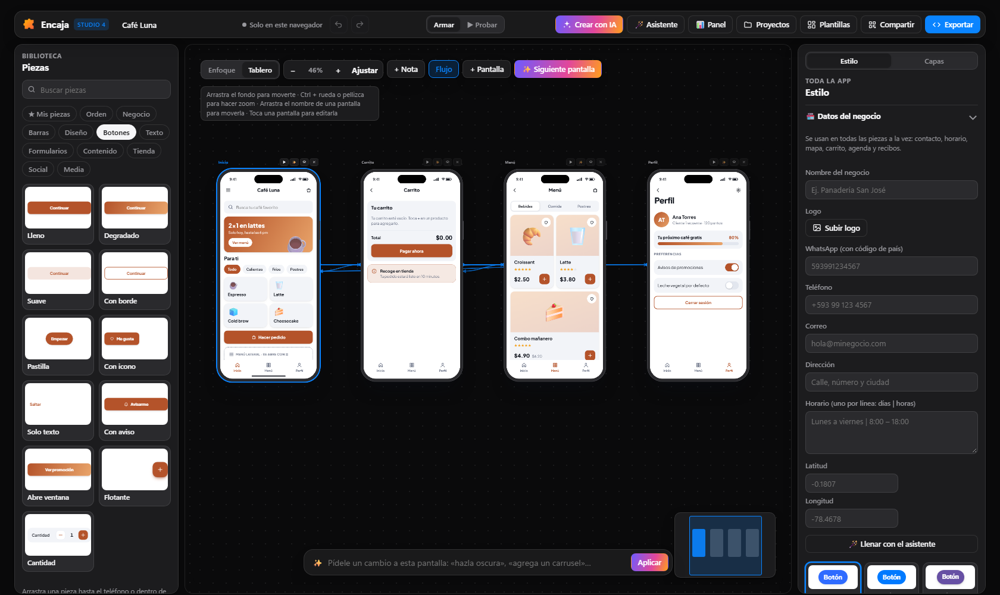

| 🧩 **+70 piezas** | 🏪 **33 apps básicas** | 📄 **22 pantallas tipo** | 🎨 **13 estilos** | 🔣 **~300 iconos** |
|:---:|:---:|:---:|:---:|:---:|
| con su nombre técnico | una por tipo de negocio | login, carrito, pago, perfil… | Cupertino, Material, Vidrio, Neón… | con buscador en español |

## 🪄 Tu app lista en 2 minutos

El **asistente paso a paso** pregunta qué negocio tienes, el nombre, el logo, los colores y tu WhatsApp, y te entrega la app con **tus datos en todas las pantallas**. Si subes tu logo, la app toma sus colores sola.

  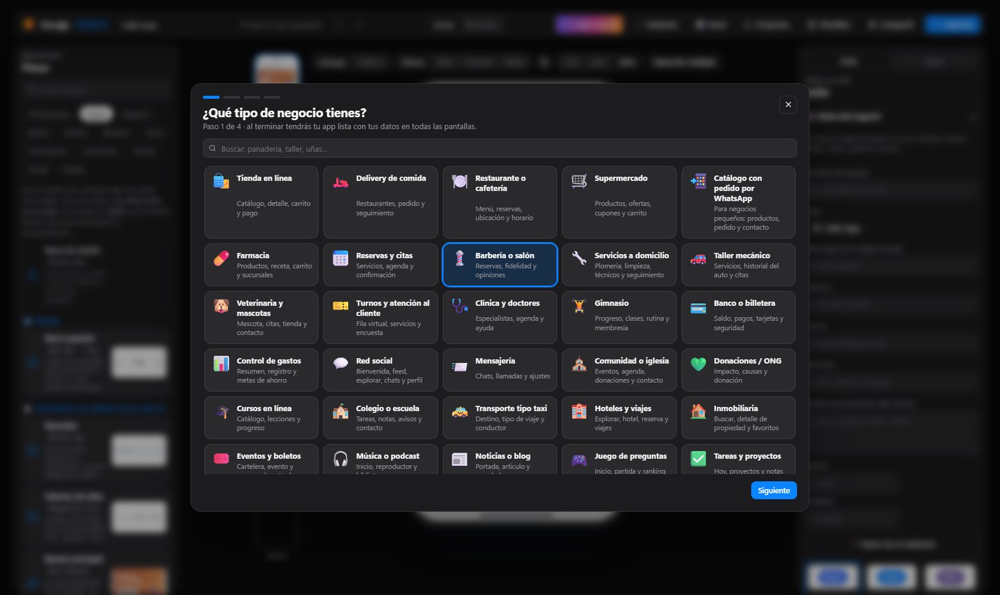

| Paso | Qué pide |
|:-:|---|
| 1 | Tipo de negocio (33 opciones) |
| 2 | Nombre, logo y colores de marca |
| 3 | WhatsApp, teléfono, correo, dirección y horario |
| 4 | Productos o servicios: pega tu lista o **sube tu Excel** |

## 🧾 Herramientas para el día a día

<table>
<tr>
<td width="55%">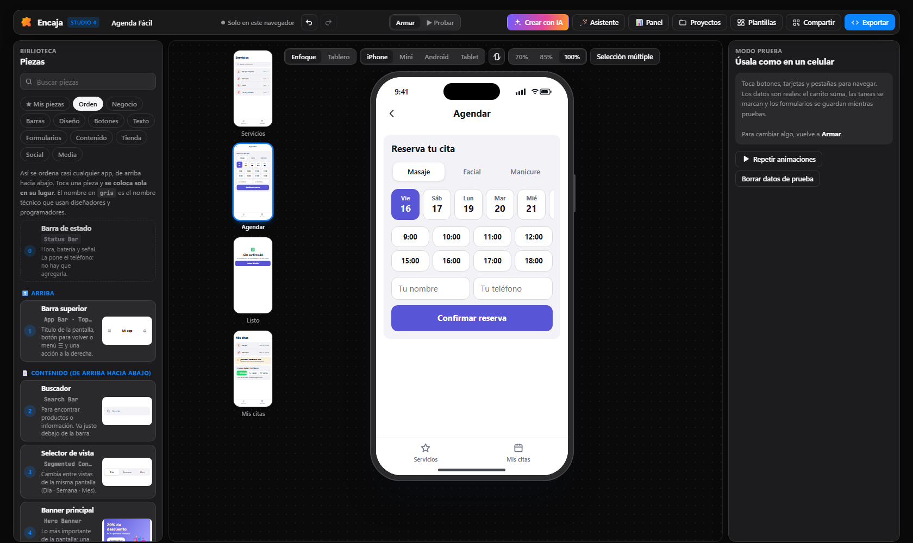</td>
<td>

- 📅 **Agenda con horarios reales:** los clientes eligen día y hora; las horas ocupadas se bloquean y no hay reservas dobles
- 🔔 **Recordatorios:** un botón para recordar por WhatsApp las citas de mañana, y un archivo de calendario con aviso un día antes
- 📥 **Importar productos** desde Excel o CSV: se crean el catálogo y el carrito solos, con emoji automático por producto
- 🏪 **Datos del negocio en un solo lugar:** nombre, logo, WhatsApp, dirección y horario se llenan en todas las piezas
- 🧾 **Recibos en PDF** de cada pedido
- 📊 **Panel del dueño:** pedidos, reservas, opiniones, formularios y turnos en tiempo real, con estados y descarga en CSV
- 🍽️ **Menú del día editable desde el celular,** sin entrar al editor
- 🖨️ **Cartel con QR** para imprimir en la mesa o la vitrina

</td>
</tr>
</table>

## 📐 El orden de una app, explicado

¿No sabes qué va primero? La sección **Orden** muestra las piezas en el orden estándar de cualquier app móvil, de arriba hacia abajo, siguiendo las guías de **Material Design 3** (Google) y **Human Interface Guidelines** (Apple). Cada pieza tiene su nombre en español, su **nombre técnico** y para qué sirve. Al tocarla, **se coloca sola en su lugar**.

<table>
<tr>
<td width="30%">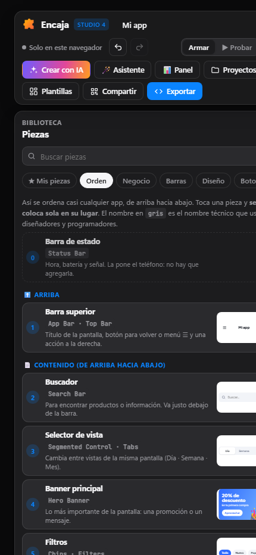</td>
<td>

| # | Pieza | Nombre técnico | Zona |
|:-:|---|---|---|
| 0 | Barra de estado | `Status Bar` | la pone el teléfono |
| 1 | Barra superior | `App Bar · Top Bar` | ⬆️ arriba |
| 2 | Buscador | `Search Bar` | 📄 contenido |
| 3 | Selector de vista | `Segmented Control` | 📄 contenido |
| 4 | Banner principal | `Hero Banner` | 📄 contenido |
| 5 | Filtros | `Chips` | 📄 contenido |
| 6 | Título de sección | `Section Header` | 📄 contenido |
| 7 | Carrusel · Cuadrícula · Tarjetas | `Carousel · Grid · Card` | 📄 contenido |
| 8 | Lista | `List` | 📄 contenido |
| 9 | Campos de texto | `Text Field` | 📄 contenido |
| 10 | Botón principal | `Primary Button · CTA` | 📄 contenido |
| 11 | Botón flotante | `FAB` | 🎈 flotante |
| 12 | Barra de pestañas | `Tab Bar · Bottom Navigation` | ⬇️ abajo |
| — | Menú lateral · Ventana · Aviso | `Drawer · Modal · Toast` | 🪟 encima |

</td>
</tr>
</table>

Al pasar el cursor sobre cualquier pieza del teléfono aparece su nombre técnico, y también se ve en el inspector y en las capas. Así aprendes el vocabulario que usan diseñadores y programadores.

## 🏪 33 apps básicas, una para cada negocio

Elige tu tipo de app y empieza con la estructura correcta: pantallas en orden, navegación conectada y textos de ejemplo listos para cambiar.

  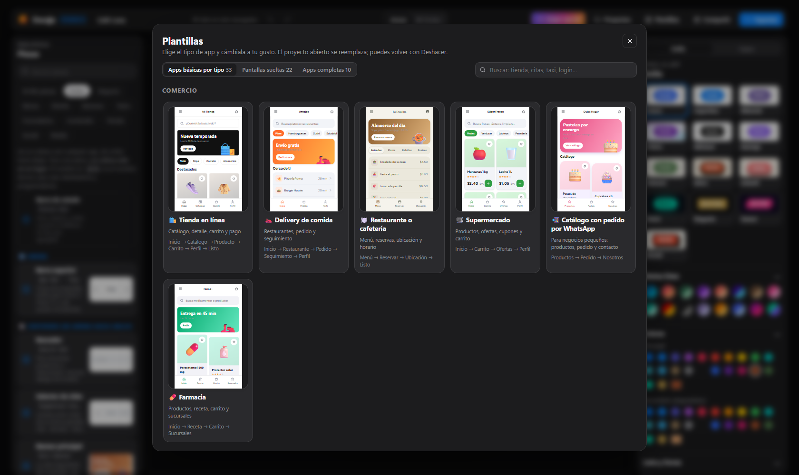

| Grupo | Apps |
|---|---|
| 🛍️ **Comercio** | Tienda en línea · Delivery de comida · Restaurante o cafetería · Supermercado · Catálogo con pedido por WhatsApp · Farmacia |
| 🧰 **Servicios** | Reservas y citas · Barbería o salón · Servicios a domicilio · Taller mecánico · Veterinaria · Turnos y atención al cliente |
| 🩺 **Salud y bienestar** | Clínica y doctores · Gimnasio |
| 💳 **Finanzas** | Banco o billetera · Control de gastos |
| 💬 **Social** | Red social · Mensajería · Comunidad o iglesia · Donaciones / ONG |
| 🎓 **Educación** | Cursos en línea · Colegio o escuela |
| 🚕 **Movilidad y viajes** | Transporte tipo taxi · Hoteles y viajes · Inmobiliaria |
| 🎟️ **Entretenimiento** | Eventos y boletos · Música o podcast · Noticias o blog · Juego de preguntas |
| ✅ **Productividad** | Tareas y proyectos · Formulario y encuesta · Inventario de negocio |
| 👤 **Personal** | Portafolio o tarjeta digital |

Y **22 pantallas sueltas** para agregar a cualquier app: *Login, Sign Up, Onboarding, Home, Product Listing, Product Detail, Cart, Checkout, Success, Profile, Settings, Chat, Search, Notifications, Location, Booking, Form, Dashboard, Empty State, Help, Loyalty y Virtual Queue*.

## 🧰 Piezas para el día a día de un negocio

| Pieza | Qué resuelve |
|---|---|
| 💬 **WhatsApp y contacto** | Botones para escribir por WhatsApp con un mensaje listo, llamar o enviar un correo |
| 🛒 **Pedido por WhatsApp** | El carrito arma el pedido con productos y total, y lo envía a tu WhatsApp |
| 🕒 **Horario de atención** | Días, horas, dirección y «Abierto ahora» |
| 🏷️ **Cupón** | Código de descuento que se copia con un toque |
| ☕ **Tarjeta de sellos** | Fidelidad tipo «el 10.º café es gratis» |
| 🎫 **Fila virtual** | El cliente toma turno desde el celular y ve cuántas personas faltan |
| 😍 **Encuesta de satisfacción** | Caritas del 1 al 5 que se guardan en la lista de datos |

  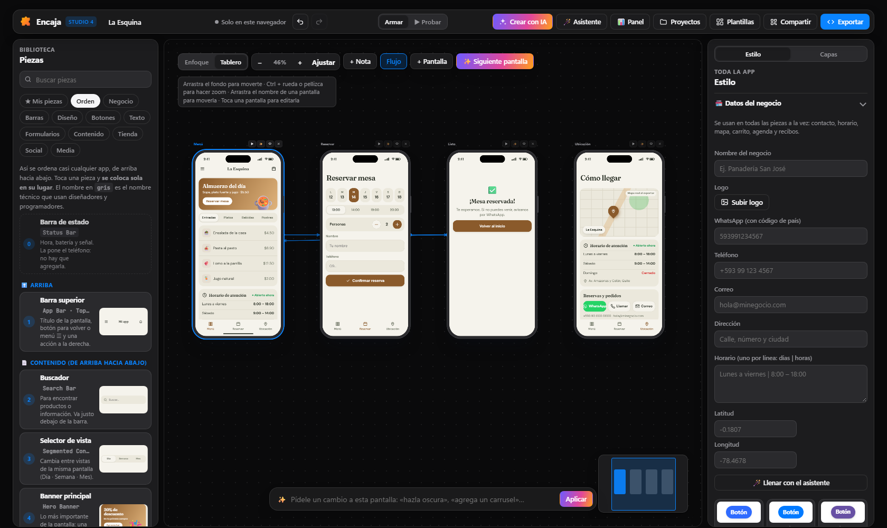

## 🗺️ El tablero

Todas las pantallas a la vista. Muévete por un lienzo infinito, haz zoom, reordena las pantallas y mira el **flujo** de tu app con flechas que muestran qué botón lleva a dónde.

<table>
<tr>
<td width="50%">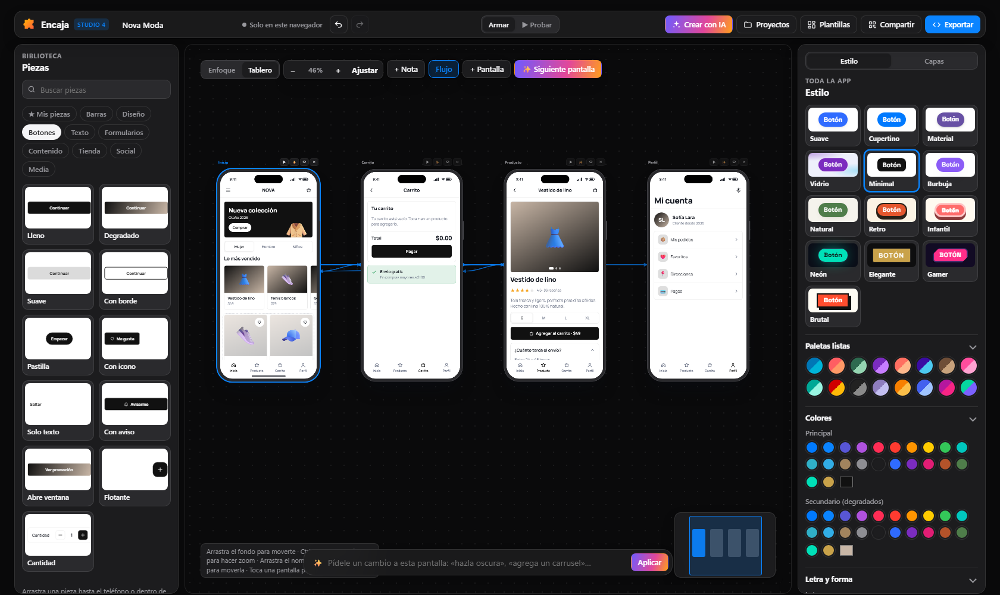</td>
<td width="50%">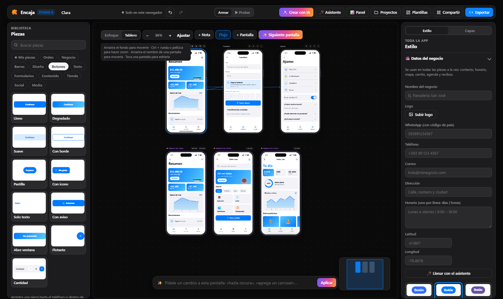</td>
</tr>
<tr>
<td><b>Flujo de prototipo</b> flechas entre pantallas, minimapa, notas adhesivas y ▶ probar desde cualquier pantalla</td>
<td><b>✨ Variantes con IA</b> tres versiones distintas de una pantalla, lado a lado; eliges la que te gusta</td>
</tr>
</table>

| Gesto | Qué hace |
|---|---|
| Arrastrar el fondo | Moverte por el tablero |
| `Ctrl` + rueda · pellizcar | Zoom |
| Arrastrar el nombre de una pantalla | Moverla |
| `Mayús` + `1` · `0` · `F` | Ver todo · 100 % · centrar la pantalla activa |

## 🧠 Inteligencia artificial

- **Crear con IA:** describes la app (*"reservar canchas de fútbol"*) y la arma con piezas reales, que luego editas a mano.
- **De boceto a app:** sube una foto de tu dibujo o una captura y la IA copia el diseño.
- **Siguiente pantalla:** la IA diseña la pantalla que sigue y la conecta a un botón.
- **Pídele un cambio:** *"hazla oscura"*, *"agrega un carrusel"*… y lo aplica.

> La IA, la nube y la colaboración funcionan dentro de Claude, con la cuenta de cada persona. En la demo pública todo lo demás funciona y se guarda en tu navegador.

## 🛠️ Edición profesional

<table>
<tr>
<td width="62%">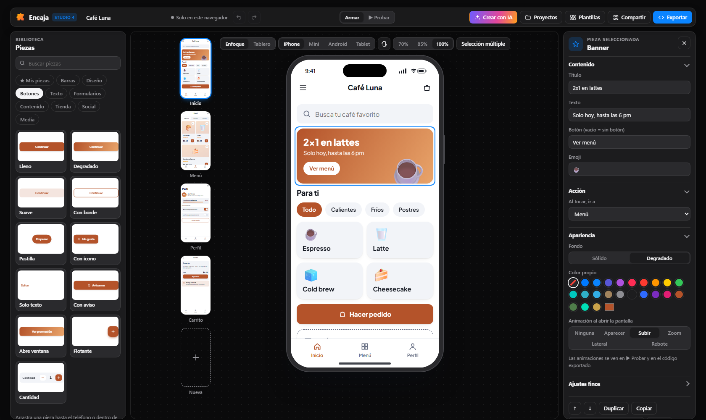</td>
<td width="38%">

- **Filas y rejillas** para poner piezas lado a lado
- **Inspector** por secciones: contenido, acción, apariencia y ajustes finos
- **Ajustes finos:** márgenes, relleno, escala, opacidad, sombra, esquinas y fondo con foto
- **Capas**, selección múltiple, copiar y pegar entre pantallas
- **Mis piezas:** guarda bloques propios y reúsalos
- **Animaciones** de entrada por pieza
- Deshacer y rehacer ilimitado

</td>
</tr>
</table>

## ⚡ Datos que funcionan de verdad

Las apps no son dibujos: el **carrito suma precios**, las **tareas se marcan y se guardan**, los **formularios guardan lo que escribes**, el **menú lateral** y las **ventanas emergentes** se abren, y la **bienvenida** avanza paso a paso. Todo eso también funciona en el código exportado.

  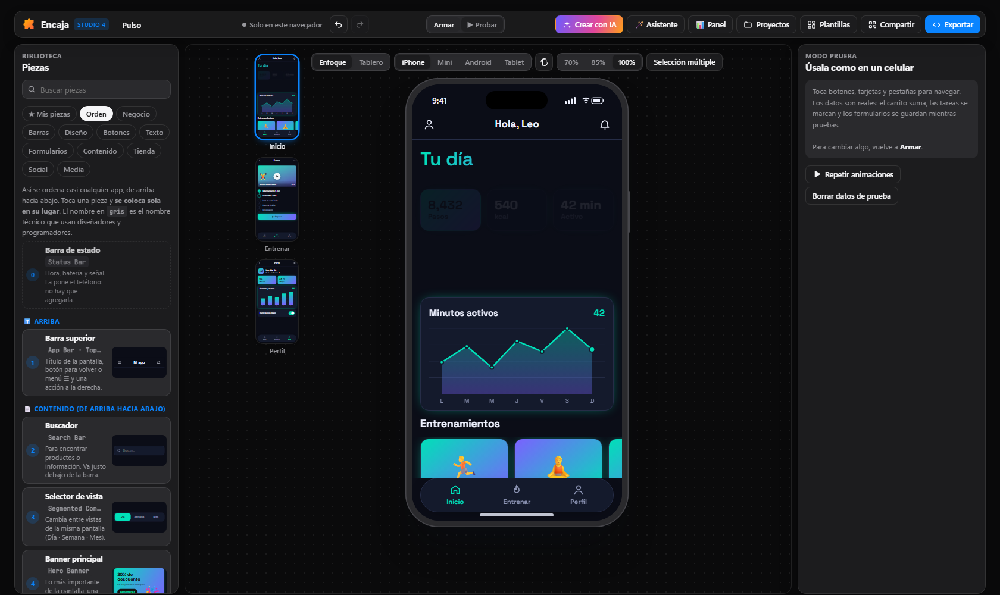

## 📦 Exporta código real

<table>
<tr>
<td width="55%">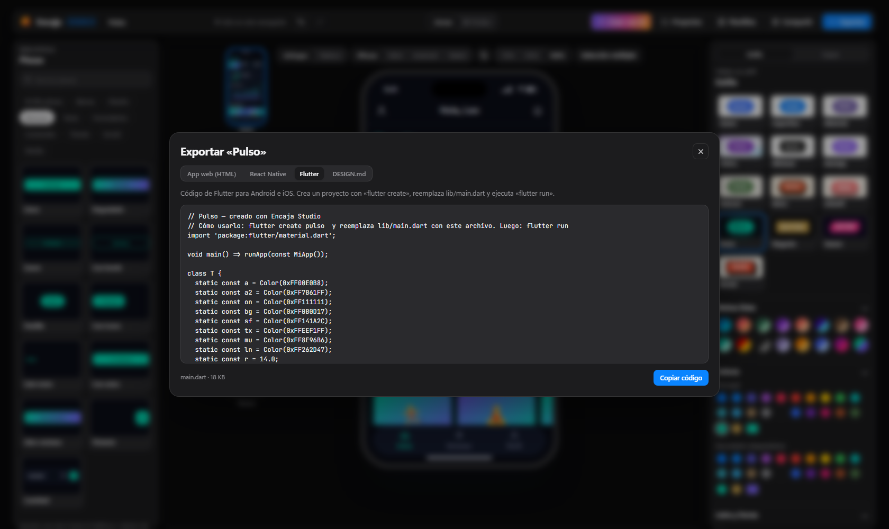</td>
<td width="45%">

| Formato | Para qué |
|---|---|
| 🌐 **HTML** | Abrir en cualquier celular o subir a un hosting |
| ⚛️ **React Native** | Proyecto Expo, listo para App Store y Play Store |
| 💙 **Flutter** | Android e iOS con Material 3 |
| 📐 **DESIGN.md** | Guía de diseño para programadores o para otra IA |
| 🗜️ **.zip** | Todo junto, con instrucciones |

</td>
</tr>
</table>

## 🖼️ Plantillas

  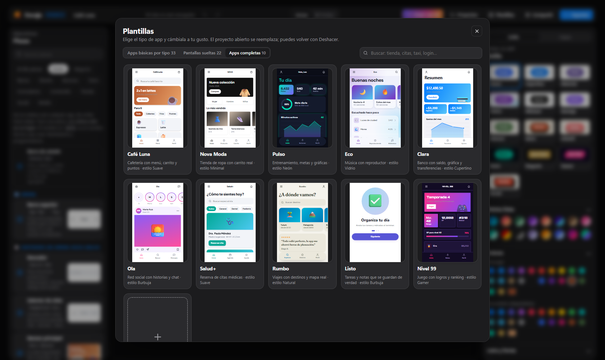

## 🔄 Cómo funciona

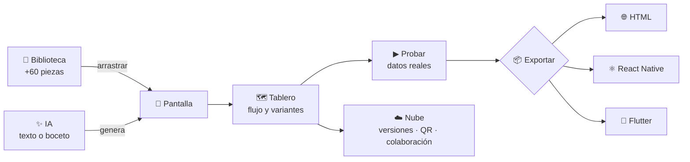

## 📱 También en el celular

  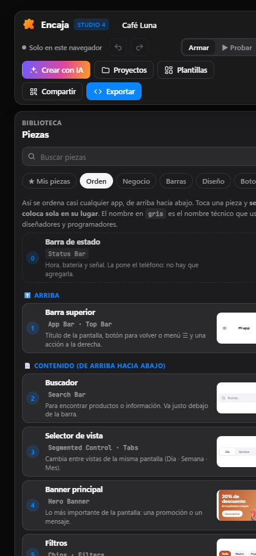

Mantén pulsada una pieza y arrástrala; con un toque se añade al final.

## 🛠️ Novedades de la versión 4.4 · Encaja Pro

Herramientas para diseñadores y programadores. Aquí no te quedas con lo que genera una máquina: cada pieza se mide, se ajusta y se lleva a código limpio.

| | Herramienta | Qué resuelve |
|:---:|---|---|
| `</>` | **Modo Dev** | Medidas, relleno, márgenes, esquinas, letra y contraste de cada pieza. Pasa el ratón por otra pieza y ves la distancia entre las dos. Código de la pieza en HTML, CSS, Tailwind y JSON. |
| 🎨 | **Tokens de diseño** | Tu marca como código en formato estándar **DTCG 2025.10**, CSS, **Tailwind v4**, React Native, Flutter y SwiftUI. También **importa** los tokens de tu sistema de diseño. |
| ✅ | **Revisión de calidad** | Contraste **WCAG 2.2**, áreas para tocar de 44 px, botones sin destino, pantallas a las que no se llega y textos vacíos. Puntaje de 0 a 100 y **arreglos con un clic** que conservan el color de tu marca. |
| 🧪 | **Laboratorio** | La pantalla en 5 tamaños a la vez (320 px a tablet), con **letra grande**, **modo oscuro** y simulación de **daltonismo**. |
| ◐ | **Estados de pantalla** | Mira cada pantalla **cargando** (esqueleto automático), **vacía**, con **error** o **sin conexión**, y conviértelas en pantallas editables. |
| ⌘ | **Paleta de comandos** | `Ctrl` + `K`: cualquier acción, pieza, pantalla o plantilla al instante. |
| 🧩 | **CSS y HTML propios** | CSS para toda la app o para cada pieza (con anidado `& button{…}`) y una pieza de **Código HTML** saneada para incrustar lo que quieras. |
| ⌨️ | **Encaja Code** | Toca cualquier pieza y pulsa **«Cambiar código»**: se abre una terminal propia con HTML, CSS y datos de la pieza, resaltado de sintaxis y comandos (`color`, `radio`, `sombra`, `vidrio`, `texto`…). Lo que escribes aparece en el teléfono **en tiempo real**, y los comandos se escriben solos para que veas cómo se crea el código. Dentro de Claude, además, `ia <pedido>` reescribe la pieza. |
| 📐 | **Especificación** | Un documento HTML para el programador: colores con contraste, tipografía, cada pantalla con sus piezas, destinos y lista de entrega. |

<table>
<tr>
<td width="50%">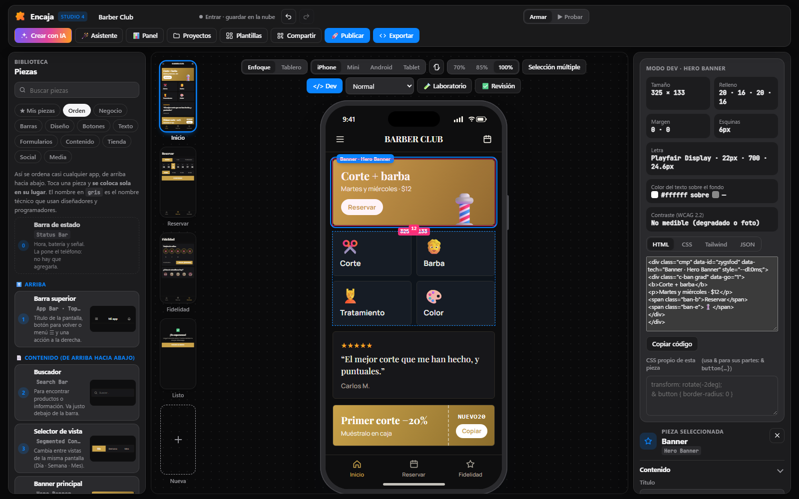</td>
<td width="50%">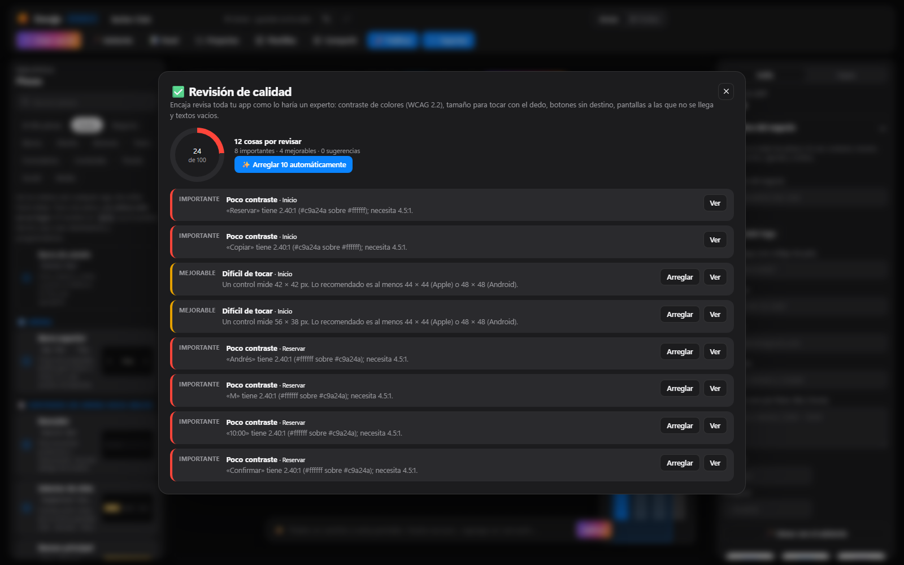</td>
</tr>
<tr>
<td width="50%">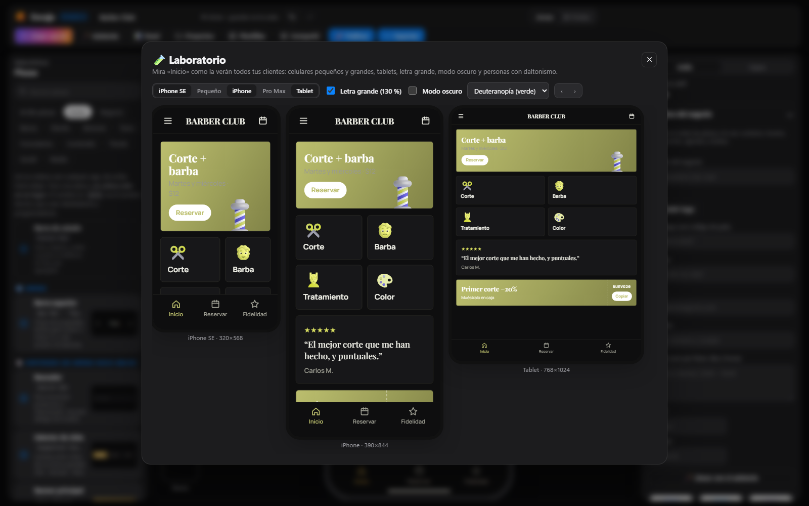</td>
<td width="50%">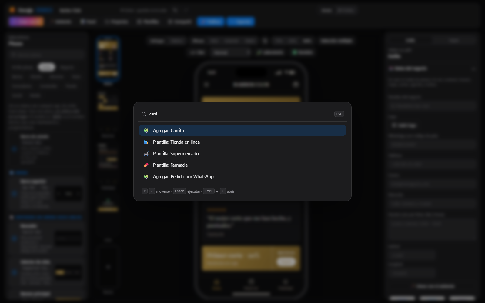</td>
</tr>
</table>

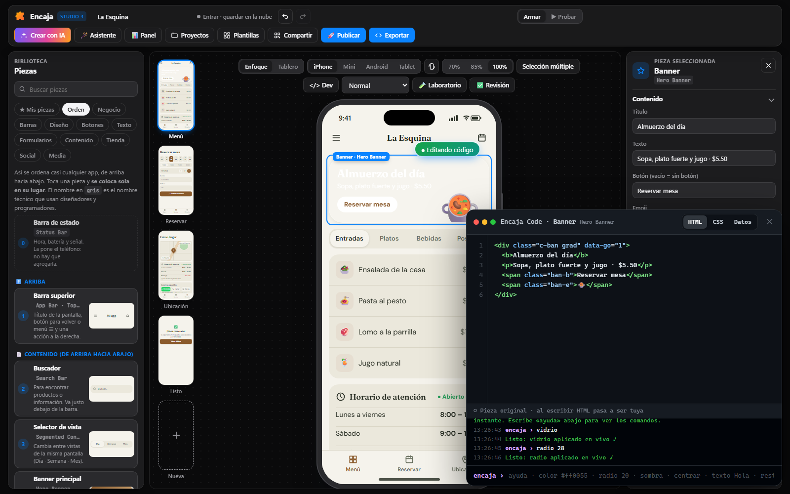

## 🚀 Novedades de la versión 4.2

- 🪄 Asistente paso a paso con logo y colores automáticos
- 📥 Importar productos desde Excel o CSV
- 🏪 Datos del negocio compartidos por todas las piezas
- 📅 Agenda con horarios reales, sin reservas dobles, y recordatorios
- 📊 Panel del dueño en tiempo real, con descarga en CSV
- 🧾 Recibos en PDF · 🍽️ menú del día editable desde el celular · 🖨️ cartel con QR para el local

### Versión 4.1

- 📐 Sección **Orden** con el orden estándar de una app y nombres técnicos; las piezas se colocan solas en su lugar
- 🏪 **33 apps básicas** por tipo de negocio y **22 pantallas sueltas**
- 🧰 Piezas para negocios: WhatsApp, pedido por WhatsApp, horario, cupón, sellos, fila virtual y encuesta
- 🏷️ Nombre técnico de cada pieza al pasar el cursor, en el inspector y en las capas

### Versión 4.0

- 🗺️ **Tablero infinito** con zoom, pantallas que se mueven, flechas de flujo, minimapa y notas
- ✨ **Variantes**, **siguiente pantalla** y **cambios por texto** con IA
- 🔲 **Rejillas** de 2 y 3 columnas
- 📐 Exportación de **DESIGN.md**

<b>Versiones anteriores</b>

- **3.0** · IA, nube con historial, QR para el celular, colaboración en vivo, filas, datos reales, ~300 iconos, React Native y Flutter
- **2.0** · interfaz estilo Apple, 13 estilos, 16 paletas, 9 plantillas, animaciones
- **1.0** · arrastrar y soltar, 6 estilos, exportar HTML

## 🧭 Próximamente

- [x] Paleta de comandos (`Ctrl` + `K`)
- [ ] Colecciones de datos que llenan listas y tarjetas
- [x] Publicar la app en internet con un clic → [encaja.analista-datos-pro.workers.dev](https://encaja.analista-datos-pro.workers.dev)
- [x] Revisión automática de contraste y botones sin destino
- [ ] Capturas para App Store y Play Store

## 👤 Creador

**Encaja Studio es una idea original de [@fleremiasflemin20-maker](https://github.com/fleremiasflemin20-maker)**, que lo concibió, diseñó y desarrolló de principio a fin: el concepto de armar apps como un rompecabezas, las piezas, las plantillas por tipo de negocio, el panel del dueño y la plataforma para publicar.

## 🔒 Licencia

**© 2026 Fleremiasflemin. Todos los derechos reservados.**
El código fuente de Encaja Studio es privado. Este repositorio solo publica la demo y su documentación; puedes usar la app desde el enlace, pero no copiar, modificar ni redistribuir su código. Más detalles en [LICENSE](./LICENSE).

 

